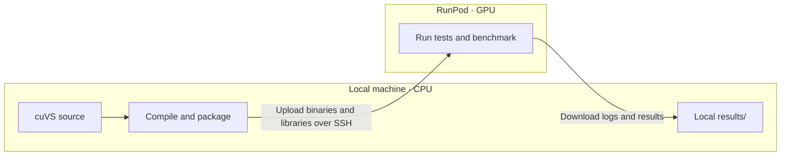

# cuVS build and RunPod workflow

`cuvs_build` is a utility project for developing cuVS when your local machine
lacks suitable GPU resources and you need a remote GPU provider such as RunPod.
It compiles cuVS locally, uploads the programs and required libraries, then runs
tests and a small benchmark on the remote GPU. Logs and results are downloaded
for review. The cuVS source stays in its own checkout, with a dedicated build
folder for this workflow.

## Where things run



A local GPU is not required. RunPod executes the programs compiled locally.

## Setup

Both machines must run Linux x86_64. Locally, you need Python 3, Conda, Make,
SSH, and rsync. RunPod needs an NVIDIA GPU and driver.

On a new checkout, create your local configuration files:

```sh
cp .env.example .env
cp runpod.ssh.example runpod.ssh
```

| File | What to set |
| --- | --- |
| `.env` | Set `CUVS_SOURCE_DIR` to your local cuVS checkout. Loaded automatically and ignored by Git. |
| `runpod.ssh` | Set the pod address, SSH port, and key. Also ignored by Git. |
| `config/build.json` | Choose build paths, compiler versions, build jobs, targets, and test options. |

Relative paths start from this repository. Configuration uses
`${CUVS_SOURCE_DIR}` to find the checkout. Build output goes into its dedicated
`cpp/build-runpod` folder by default.

If your SSH key has a passphrase, unlock it with `ssh-add`. Then prepare the
environment and configure the build:

```sh
make setup
```

This also inspects RunPod and saves its hardware information in
`config/runpod.json`.

## Development cycle

After editing cuVS, run the complete cycle from this directory:

```sh
make cycle
```

The cycle is **build → package → upload → test → benchmark → download results**.
Review the reports in `results/`, update your code, and repeat.

To run individual steps:

| Command | What it does |
| --- | --- |
| `make build` | Compile the selected libraries, tests, and benchmark locally. |
| `make publish` | Build, package, and upload a new release to RunPod. |
| `make test` | Run native C++ and C API tests from the last published release. |
| `make benchmark` | Run the small benchmark from the last published release. |
| `make fetch` | Download logs and reports into `results/`. |
| `make smoke` | Check local compilation and remote GPU execution with a tiny program. |
| `make check` | Run local checks for this workflow without SSH or a GPU. |

When changing pods, run `make inventory` to refresh hardware information.
Use `make configure` to refresh the build configuration, `make ssh` to open a
remote shell, and `make help` for the full command list.
